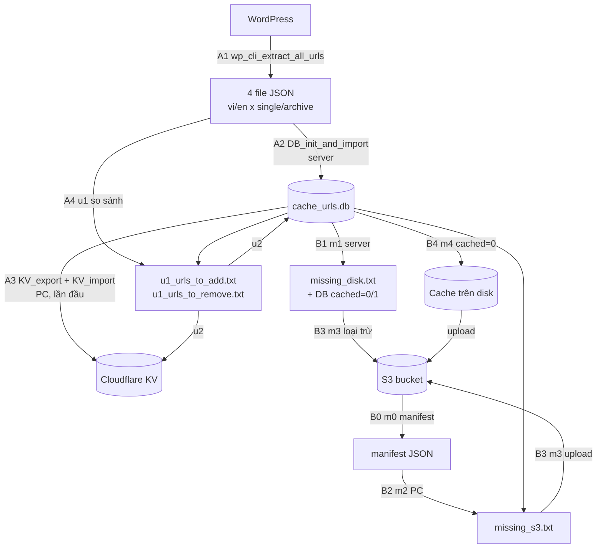

# Bộ Tool Cache – diaocthongthai.com

Claude maithanhtruc: https://claude.ai/chat/1a138c9d-bcc9-44fb-9285-b7f090853791

> Tài liệu tổng hợp từ code các tool và note cũ `_Note_cache_Tools.docx` (2025-10-23, 2025-11-01).
> Mục đích: đọc lại là hiểu ngay từng tool làm gì, chạy ở đâu, cần gì để chạy, và chạy theo thứ tự nào.

---

## 1. Bức tranh tổng thể

Bộ tool quản lý **cache HTML của site WordPress** (WP Rocket), đồng bộ cache lên S3 và danh sách URL hợp lệ lên Cloudflare KV.

| Thành phần | Vai trò |
|---|---|
| **WordPress** | Nguồn sự thật: bài nào đang publish thì phải có cache |
| **SQLite `cache_urls.db`** | Danh sách URL cần cache. Các cột chính: `url`, `lang`, `page_type`, `cached`, `last_update`, `page_number`, `in_progress`. Bảng phụ `url_tags` |
| **Disk server (WP Rocket)** | Nơi sinh cache. Mỗi URL có 4 file: `index-https.html`, `index-https.html_gzip`, `index-mobile-https.html`, `index-mobile-https.html_gzip` |
| **S3 (Linode Object Storage)** | Bản sao cache, bucket `cdn.diaocthongthai.com`, prefix `_cache_html/` |
| **Cloudflare KV** | Danh sách URL hợp lệ để Worker tra cứu |
| **`utils.py`** | Thư viện lõi dùng chung: `trigger_cache`, `url_to_cache_paths`, `upload_files_to_s3`, `is_cache_file_exists`, `check_cpu_usage_and_wait`, `read_urls_from_file`, `write_urls_to_file`, `TARGET_DIR`, `BUCKET_CONFIGS`, `S3_PREFIX`... (**file này không nằm trong bộ upload, chức năng suy ra từ cách các tool gọi**) |

### Đường dẫn làm việc (theo note)

- PC: `D:\Real\Python\2025-01-18 s3 sync with boto3\2025-09-05_S3_Sync_Object_S3_to_S3_v6\cache-tools-new\`
- Server: `/root/tool/diaocthongthai.com/cache-tools/` (DB ở `output/cache_urls.db`)

---

## 2. Sơ đồ luồng dữ liệu

---

## 3. Pipeline theo thứ tự

Ký hiệu: **[PC]** chạy trên máy Windows, **[SV]** chạy trên server Linux.

### Giai đoạn A. Dựng và đồng bộ danh sách URL

| # | Tool | Chạy ở | Làm gì | Yêu cầu / Input |
|---|---|---|---|---|
| A1 | `wp_cli_extract_all_urls.py` | PC | Dùng WP-CLI qua SSH lấy toàn bộ URL bài đơn và trang archive (có phân trang, lọc theo `exclude_patterns`). Ghi ra 4 JSON trong `./output/`: `vi_single_post_urls.json`, `vi_archive_page_urls.json`, `en_single_post_urls.json`, `en_archive_page_urls.json` | File config `settings.py` / `settings_en.py` (SSH credentials, WP path, site URL); thư viện `paramiko`; WP-CLI cài sẵn trên server; kết nối SSH tới server. Phụ thuộc thư mục `config` nên **chỉ chạy được trên PC** |
| A2 | `DB_init_and_import.py` | SV | **Chạy 1 lần đầu.** Tạo DB (bảng `urls`, `url_tags`) và import 4 JSON. Tự nhận `lang` (prefix `en_`/`vi_`), `page_type` (`archive`/`single`) từ tên file, `page_number` từ `/page/N/`. Tất cả vào với `cached=0` | **4 file JSON từ A1**, upload lên cùng thư mục với tool (`/root/tool/.../output`), đúng tên file. Python + `sqlite3` |
| A3a | `KV_export_db_to_kv_json.py` | PC | **Chạy 1 lần đầu.** Đọc toàn bộ URL trong DB, đổi sang **path** (`/abc/`), bỏ trùng, xuất `kv_export.json` dạng `[{"key": path, "value": "1"}]` | **`cache_urls.db` từ A2**, tải từ server về PC |
| A3b | `KV_import_json_into_KV.py` | PC | Chia `kv_export.json` thành chunk 3000 phần tử, đẩy từng chunk lên KV bằng `wrangler kv bulk put`, nghỉ 3 giây giữa các chunk (tránh gateway timeout) | **`kv_export.json` từ A3a**; `wrangler` đã cài và đã login; `NAMESPACE_ID`; thư mục tạm cho chunk (RAM disk `R:\kv_chunks`) |
| A4a | `u1_compare_json_and_db_v2.py` | PC | **Chạy định kỳ khi site có bài mới/xóa.** So sánh URL trong JSON mới với URL trong DB, ghi `u1_urls_to_add.txt` và `u1_urls_to_remove.txt`. **Không normalize**, giữ nguyên format (lowercase + dấu `/` cuối) | Thư mục `wp_url_jsons/` chứa **JSON mới từ A1**; **`cache_urls.db` bản mới nhất** trên PC |
| A4b | `u2_update_db_and_kv_v3.3.py` | PC | Backup DB vào `backups/`, rồi thêm/xóa URL trên **DB** và **KV** theo 2 file của u1. Có cờ `DRY_RUN`, `DISABLE_DB`, `DISABLE_KV` | **`u1_urls_to_add.txt`, `u1_urls_to_remove.txt` từ A4a**; `cache_urls.db` trên PC; `wrangler login` trước khi chạy; `NAMESPACE_ID`; thư mục chunk `R:\kv_chunks` |

### Giai đoạn B. Kiểm kê và vá thiếu (note 2025-11-01)

Đối chiếu 3 nơi: DB, disk, S3.

| # | Tool | Chạy ở | Làm gì | Yêu cầu / Input |
|---|---|---|---|---|
| B0 | `m0_pc_s3_manifest_generator_v2_asyncio.py` | PC | Liệt kê toàn bộ object trên S3 (asyncio + aiobotocore, 200 request song song), ghi thành các `file_manifest_XXXX.json` (2000 file/manifest) vào thư mục `manifest-s3-cache-<timestamp>/` | `aiobotocore`, `aiofiles`; **S3 endpoint + access key + secret key**; tên bucket và prefix `_cache_html/`; mạng tới Linode |
| B1 | `m1_sv_check_missing_disk.py` | SV | Với mỗi URL trong DB, kiểm tra cache có trên disk không. Cập nhật `cached=0/1` và `last_update` trong DB, ghi các URL thiếu vào `missing_disk.txt` | **`cache_urls.db` từ A2/A4b** (`output/cache_urls.db` trên server); `utils.py`; thư mục cache WP Rocket (`TARGET_DIR`) |
| B2 | `m2_pc_check_missing_s3_v2.py` | PC | Lấy "URL trong DB" trừ "URL có trong manifest S3", ghi `missing_s3.txt`. Chỉ xét `index-https.html` và `index-mobile-https.html`, bỏ qua `_gzip` | **Thư mục manifest từ B0** (`MANIFEST_DIR`); **`cache_urls.db`** trên PC (`DB_PATH`). Note ghi "cần `missing_disk.txt`" nhưng code **không đọc** file này, chỉ m3 dùng. Sau khi chạy, **upload `missing_s3.txt` lên server** |
| B3 | `m3_upload_missing_s3.py` | SV | Upload lên S3 các URL thuộc `missing_s3` **mà không thuộc `missing_disk`** (có trên disk nhưng thiếu trên S3). Chạy 10 luồng | **`missing_s3.txt` từ B2** (đã upload lên server); **`missing_disk.txt` từ B1**; `utils.py` (cấu hình S3); file cache đã có sẵn trên disk |
| B4 | `m4_sv_create_missing_disk.py` | SV | Với URL `cached=0` trong DB: trigger tạo cache bằng curl, upload S3, set `cached=1`. Chạy rất lâu (nhiều ngày) | **DB đã có cột `cached` đúng** (từ B1, hoặc URL mới từ A4b với `cached=0`); `utils.py`; site WordPress truy cập được từ server (curl); cấu hình S3; CPU đủ rảnh (`check_cpu_usage_and_wait`) |

**Thứ tự chạy:** B0 và B1 độc lập nhau, chạy trước. B2 cần B0. B3 cần B1 + B2. B4 chỉ cần DB đã có `cached=0` từ B1, nên có thể chạy song song với B2/B3.

**Lý do thứ tự:** URL thiếu trên disk thì chưa có gì để upload nên phải tạo cache trước (B4). URL đã có trên disk mà thiếu S3 thì chỉ cần upload (B3).

### Giai đoạn C. Vận hành và bảo trì (đều chạy trên server)

| Tool | Làm gì | Yêu cầu / Input |
|---|---|---|
| `cache_renew_from_db.py` | **Vòng lặp vô hạn**: lấy batch URL cũ nhất (`last_update` ASC), khóa bằng `in_progress=1`, xóa cache cũ, tạo lại, upload S3, `cached=1`. Graceful shutdown bằng Ctrl+C | `cache_urls.db` có cột `in_progress`; `utils.py`; site truy cập được qua curl; nên chạy trong `screen`/service |
| `cache-urls-update.py` | Làm mới thủ công danh sách URL: xóa cache local, trigger lại, upload S3 | File **`cache-urls-update.txt`** (mỗi dòng 1 URL), cùng thư mục với tool; `utils.py`. **Không cần DB** |
| `cache-segment-update.py` | Làm mới theo category/archive (tương tác): chỉ archive, archive + bài, hoặc chỉ bài | Nhập link archive khi chạy; `utils.py`; `requests`, `beautifulsoup4`, `lxml`. **Không cần DB** |
| `cache_create_from_db.py` | Tạo cache cho URL chưa có trên disk (bản đời đầu của m4) | `cache_urls.db`; `utils.py`. **Đang có bug**, xem mục 4 |
| `cache_clean_from_db.py` | Dọn cache mồ côi (thư mục trên disk và S3 không còn khớp URL nào trong DB). Tự xóa `/search/` | `cache_urls.db` **đầy đủ và đã đồng bộ với WordPress** (nếu DB thiếu URL thì cache hợp lệ sẽ bị xóa nhầm); `utils.py` (`TARGET_DIR`, `S3_PREFIX`, `BUCKET_CONFIGS`); tên bucket qua `--bucket` |
| `DB_scan_n_update_cache_status.py` | Quét disk để đồng bộ `cached`/`last_update` vào DB (lấy mtime của `index-https.html`), kèm thống kê (`--stats-only`). Là bản đời đầu của m1 | `cache_urls.db`; `utils.py` (`TARGET_DIR`) |

### Đã bỏ

| Tool | Lý do (theo note) | Yêu cầu / Input (nếu chạy lại) |
|---|---|---|
| `1_cache_manifest_generator.py` | Tạo manifest từ thư mục WP Rocket thay vì từ DB, nên không chuẩn. Thay bằng B0 + B2 | Chạy trên server, đường dẫn `CACHE_DIR` của WP Rocket |
| `2_cache_sync_to_s3.py` *(không có trong upload)* | Upload toàn bộ cache WP Rocket lên S3, không chuẩn. Thay bằng B3 | — |
| `3_cache_kv_export.py` *(không có trong upload)* | Đẩy KV dựa theo file trên disk, không chuẩn. Thay bằng A3 | — |

---

## 4. Các điểm nên kiểm tra lại

Quan sát khi đọc code, **chưa chạy thử**.

1. **`cache_create_from_db.py` có bug:** gọi `are_cache_file_exists(...)` nhưng import là `is_cache_file_exists`, nên sẽ báo `NameError`. Nên dùng B4 (m4) thay thế.
2. **Định dạng key KV không thống nhất:** `KV_export_db_to_kv_json.py` ghi key dạng **path** (`/abc/`), còn `u2` ghi và xóa key bằng **URL đầy đủ** (`https://.../abc/`). Cần xác nhận Worker tra key theo dạng nào.
3. **u2 thêm URL thiếu metadata:** câu `INSERT` chỉ điền `url` và `cached`. `lang`, `page_type`, `page_number` bị NULL, nên khi chạy tool với `--lang` hoặc `--page_type` các URL mới sẽ bị bỏ qua (chạy mặc định `all` thì không sao).
4. **m2 v2 không còn phát hiện "thiếu một nửa":** URL được tính là có trên S3 nếu có **một trong hai** file (desktop hoặc mobile). Docstring ghi "đủ 2 version" nhưng code không kiểm tra. Bản cũ có `missing_s3_plus.txt` để bắt trường hợp này.
5. **m1 chỉ gọi `is_cache_file_exists(files[0])`:** note ghi là kiểm đủ 4 file, nhưng điều đó chỉ đúng nếu hàm trong `utils.py` tự kiểm cả 4. Cần mở `utils.py` xác nhận.
6. **`pre_clean_search_dir` trong `cache_clean_from_db.py`** chỉ xóa `/search/` trên disk. Docstring nói xóa cả trên S3 nhưng code không làm.
7. **Đồng bộ DB giữa PC và server không được ghi rõ:** u2 cập nhật DB trên PC, còn m1/m4 cập nhật DB trên server. Note không nói cách đưa DB qua lại. Cần xác nhận quy trình để tránh hai bản DB lệch nhau.

---

## 5. Bảo mật

- File note `.docx` chứa **access key và secret key của Linode Object Storage ở dạng plain text** (copy từ m0). Nếu note hoặc script từng bị chia sẻ, commit lên git hoặc gửi cho người khác, nên **rotate key** và chuyển sang đọc từ biến môi trường.
- `NAMESPACE_ID` của Cloudflare KV đang hardcode trong `KV_import_json_into_KV.py` và `u2_update_db_and_kv_v3.3.py`. Không phải bí mật nghiêm trọng nhưng nên đưa vào config chung.
