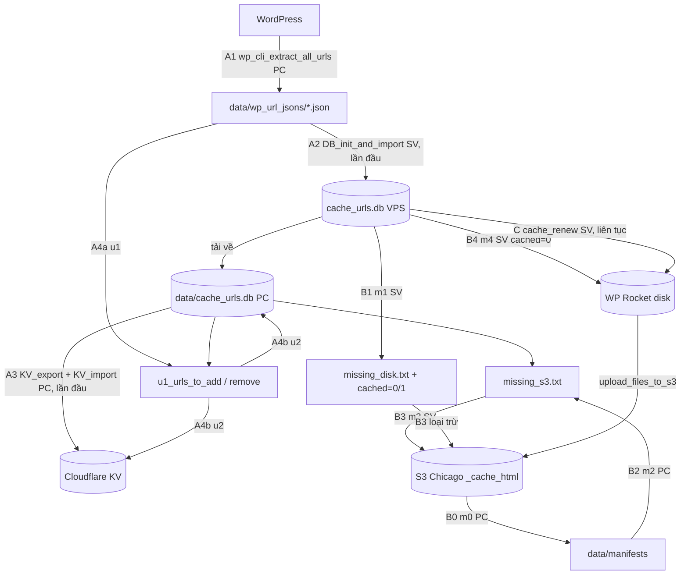

# Pipeline cache – diaocthongthai.com

> Bản cập nhật ngày 2026-11-25 của `_Note_cache_tools_pipeline_ORIGINAL.md`. Đã đối chiếu với code thực tế trên PC và VPS, cùng trạng thái DB thực tế.
> Ký hiệu: **[PC]** chạy trên Windows (thư mục `pc/`), **[SV]** chạy trên VPS (thư mục `server/`, deploy lên `/root/tool/diaocthongthai.com/cache-tools/`).

## 1. Thành phần

| Thành phần | Vị trí | Vai trò |
|---|---|---|
| WordPress multisite | `/home/diaocthDP4f/diaocthongthai.com/public_html` (vi `/`, en `/en/`) | Nguồn sự thật: bài nào đang publish thì phải có cache |
| WP Rocket cache (disk) | `.../wp-content/cache/wp-rocket/diaocthongthai.com/<path>/` | Mỗi URL có 4 file: `index-https.html`, `index-https.html_gzip`, `index-mobile-https.html`, `index-mobile-https.html_gzip` |
| SQLite `cache_urls.db` | VPS `cache-tools/output/cache_urls.db` (**bản gốc**), PC `data/cache_urls.db` (bản sao) | Danh sách URL cần cache và trạng thái của từng URL |
| S3 Linode | bucket `cdn.diaocthongthai.com`, prefix `_cache_html/`, vùng **Chicago (us-ord-1)** | Bản sao cache, ACL public-read |
| Cloudflare KV | namespace `cc831ca12e954d0b8a875a3453abacc7` | Danh sách URL hợp lệ để Worker tra cứu |
| `utils.py` | `server/utils.py` | Thư viện lõi |

### utils.py
| Tên | Chức năng |
|---|---|
| `DOMAIN`, `USER`, `TARGET_DIR` | `diaocthongthai.com`, `diaocthDP4f`, thư mục cache WP Rocket |
| `BUCKET_CONFIGS` | `thongthai_chicago` (https://us-ord-1.linodeobjects.com) và `thongthai_singapore` (https://ap-south-1.linodeobjects.com), dùng chung key và bucket `cdn.diaocthongthai.com`. Gọi bằng **boto3**, không phụ thuộc s3cmd |
| `S3_PREFIX` | `_cache_html` |
| `url_to_cache_paths(url)` | Trả về 4 đường dẫn file cache của URL |
| `is_cache_file_exists(html)` | True khi có **đủ 4 file** |
| `trigger_cache(url)` | `curl -H "Host: diaocthongthai.com" https://127.0.0.1<path> -k`, gọi 1 lần cho desktop và 1 lần với UA iPhone (gọi thẳng origin, không qua Cloudflare) |
| `upload_files_to_s3(files)` | Upload lên các bucket trong danh sách viết cứng bên trong hàm, **hiện chỉ có `thongthai_chicago`**. Đặt `ACL public-read`, `CacheControl max-age=31536000`, `ContentType text/html`; file `_gzip` có thêm `ContentEncoding gzip` |
| `are_cache_files_on_s3(html, bucket)` | HEAD object kiểm tra có cả desktop và mobile trên S3 |
| `check_cpu_usage_and_wait(70, 10)` | Chờ khi CPU vượt 70% |
| `compute_page_number`, `read_urls_from_file`, `write_urls_to_file` | Hàm tiện ích |

> Backup bằng s3cmd (`/root/.s3cfg`) đi vùng **ap-south-1 (Singapore)**, còn cache đi vùng **Chicago**. Hai vùng dùng cùng tên bucket nhưng là hai kho riêng.

### Schema `cache_urls.db`
```sql
urls(id INTEGER PK, url TEXT UNIQUE, lang TEXT, page_type TEXT, cached INT, last_update INT, page_number INT, in_progress INT)
url_tags(url_id INT, tag TEXT)   -- hiện đang trống
```
- `url`: chữ thường, có `/` ở cuối, dạng URL đầy đủ `https://diaocthongthai.com/...`
- `lang`: `vi`/`en`. `page_type`: `single`/`archive`. `last_update`: unix timestamp.
- `in_progress=1`: URL đang bị một worker khóa (cache_renew).

## 2. Sơ đồ luồng



## 3. Tool theo giai đoạn

### A. Dựng và đồng bộ danh sách URL
| # | Tool | Ở đâu | Làm gì | Input / Output |
|---|---|---|---|---|
| A1 | `pc/wp_cli_extract_all_urls.py` | PC | Dùng WP-CLI qua SSH lấy URL bài đơn và archive (có phân trang, có `exclude_patterns`) cho vi và en | Input: `pc/config/settings.py`, `settings_en.py` (SSH, WP path). Output: `data/wp_url_jsons/{vi,en}_{single_post,archive_page}_urls.json` |
| A2 | `server/DB_init_and_import.py` | SV | **Chạy 1 lần đầu.** Tạo bảng và import 4 JSON. Tự suy ra `lang`, `page_type` từ tên file, `page_number` từ `/page/N/`; tất cả vào với `cached=0` | 4 JSON đặt cùng thư mục với tool (trên VPS là `output/`) |
| A3a | `pc/KV_export_db_to_kv_json.py` | PC | Đổi URL thành **path** (`/abc/`), bỏ trùng | `data/cache_urls.db` → `data/kv_export.json` |
| A3b | `pc/KV_import_json_into_KV.py` | PC | Chia chunk 3000 phần tử, chạy `wrangler kv bulk put`, nghỉ 3 giây giữa các chunk | `data/kv_export.json`; cần `wrangler login` |
| A4a | `pc/u1_compare_json_and_db_v2.py` | PC | **Định kỳ.** So URL trong JSON mới với DB. Không chuẩn hóa URL | `data/wp_url_jsons/` + `data/cache_urls.db` → `data/u1_urls_to_add.txt`, `data/u1_urls_to_remove.txt` |
| A4b | `pc/u2_update_db_and_kv_v3.4.py` | PC | Backup DB vào `data/backups/`, thêm/xóa URL trên DB (URL đầy đủ) và KV (**key dạng path** như Worker, sửa F4 từ v3.4). Có cờ `DRY_RUN`, `DISABLE_DB`, `DISABLE_KV` (sửa trong file) | 2 file u1 + DB; cần `wrangler login` |

### B. Kiểm kê và vá thiếu (đối chiếu DB, disk, S3)
| # | Tool | Ở đâu | Làm gì | Input / Output |
|---|---|---|---|---|
| B0 | `pc/m0_pc_s3_manifest_generator_v2_asyncio.py` | PC | Liệt kê toàn bộ `_cache_html/` trên S3 Chicago (aiobotocore, 200 request song song), mỗi manifest chứa 2000 file | Output: `data/manifests/manifest-s3-cache-<ts>/file_manifest_XXXX.json` (log ghi ra thư mục đang đứng) |
| B1 | `server/m1_sv_check_missing_disk.py` | SV | Kiểm tra đủ 4 file cho mỗi URL, cập nhật `cached` và `last_update` | DB VPS → `missing_disk.txt` |
| B2 | `pc/m2_pc_check_missing_s3_v2.py` | PC | URL trong DB trừ URL có trong manifest. **Tự lấy manifest mới nhất** | `data/manifests` + DB → `data/missing_s3.txt`, sau đó **upload lên VPS** |
| B3 | `server/m3_upload_missing_s3.py` | SV | Upload các URL thuộc `missing_s3` mà không thuộc `missing_disk` (10 luồng) | `missing_s3.txt` + `missing_disk.txt` |
| B4 | `server/m4_sv_create_missing_disk.py` | SV | Với URL `cached=0`: trigger, upload S3, đặt `cached=1`. Chạy rất lâu | DB VPS. Tham số `--lang --page_type --tag --limit` |

Thứ tự: B0 và B1 độc lập, chạy trước; B2 cần B0; B3 cần B1 và B2; B4 chỉ cần B1, nên chạy song song được với B2/B3.

### C. Vận hành và bảo trì (đều trên VPS)
| Tool | Làm gì | Ghi chú |
|---|---|---|
| `cache_renew_from_db.py` | Vòng lặp vô hạn: lấy batch URL cũ nhất (`last_update ASC`), khóa bằng `in_progress=1`, xóa cache, tạo lại, upload S3 | **Đang chạy trong `screen -S F1`**. Thoát màn hình bằng Ctrl+A rồi D; dừng an toàn bằng Ctrl+C (xong batch rồi mới thoát). Tham số `--lang --page_type --tag --batch_size 50 --sleep 5` |
| `cache-urls-update.py` | Làm mới thủ công các URL trong `cache-urls-update.txt` (xóa, trigger, upload S3) | Không cần DB |
| `cache-segment-update.py` | Làm mới theo archive/category (tương tác): chỉ archive / archive + bài / chỉ bài | Cần `requests`, `bs4`, `lxml` |
| `cache_create_from_db.py` | Tạo cache cho URL chưa có trên disk (bản đời đầu của m4) | Bản trong `server/` đã sửa bug |
| `cache_clean_from_db.py` | Dọn thư mục cache mồ côi trên disk và S3 (`--bucket thongthai_chicago [thongthai_singapore]`) | ⚠️ **Chỉ chạy khi DB đã khớp với WordPress** |
| `DB_scan_n_update_cache_status.py` | Quét disk, cập nhật `cached`/`last_update` theo mtime (`--stats-only` để chỉ xem) | Bản đời đầu của m1 |
| `scan_wp_rocket_cache_for_redis_error.py` | Tìm file cache có chứa "Redis" (trang bị cache đúng lúc Redis lỗi) | Ghi ra `redis_error_pages.txt` |

### Cron cũ (`server/legacy_cron/`, trên VPS nằm ở `/root/tool/diaocthongthai.com/`)
| Script | Cron | Làm gì |
|---|---|---|
| `cron-cache-clean-v2.py` | phút 10 của các giờ 0, 4, 8, 12, 16, 20 | Đọc `url_list/clean_*.txt`. Cache cũ hơn 55 giờ (file có chữ `urgent` thì 1 giờ) bị xóa rồi tạo lại bằng curl qua domain public |
| `cron-cache-segment-update-v2.py` | 3:45 và 15:45 | Làm mới các tag/archive viết cứng ở cuối file |

Hai script này **không dùng utils.py và không upload S3**. Xem findings mục F1 và F2.

## 4. Đồng bộ DB giữa PC và VPS (quy trình đề xuất)
Bản gốc là DB trên VPS. Khi cần chạy u1/u2 (thêm/xóa URL):
1. Tải bản chụp DB từ VPS về `data/cache_urls.db` (lệnh trong README).
2. Chạy A1, rồi u1, kiểm tra 2 file kết quả, rồi chạy u2 (bật `DRY_RUN` trước).
3. **Không đẩy cả file DB lên VPS.** Thay vào đó đẩy `u1_urls_to_add.txt` và `u1_urls_to_remove.txt` lên VPS rồi áp dụng trực tiếp lên DB VPS (chỉ INSERT/DELETE). Cách này tránh ghi đè những gì renew/m1/m4 vừa cập nhật. *(Cần viết tool `u3_apply_to_server_db.py`, xem findings F5.)*
4. URL mới có `cached=0`, nên chạy B4 (m4) trên VPS để tạo cache.

## 5. Trạng thái thực tế (2026-11-25 12:36)
| lang | page_type | Số URL | cached |
|---|---|---|---|
| vi | single | 17.552 | 17.552 |
| vi | archive | 2.378 | 2.378 |
| en | single | 33.996 | 33.996 |
| en | archive | 2.896 | 2.896 |
| NULL | NULL | 3.865 | 3.865 |
| **Tổng** | | **60.687** | 100% |

- `last_update` cũ nhất là 2026-08-25, nên mỗi vòng renew mất khoảng 3 tháng.
- 44 URL `in_progress=1`, đó là batch renew hiện tại.
- `url_tags` đang trống.

## 6. Đã bỏ (`_archive/server_deprecated/`)
- `1_cache_manifest_generator.py`: tạo manifest từ thư mục WP Rocket thay vì từ DB. Đã thay bằng B0 + B2.
- `2_cache_sync_to_s3.py`: upload toàn bộ cache WP Rocket lên S3. Đã thay bằng B3.
- `3_cache_kv_export.py`: đẩy KV dựa trên file trên disk. Đã thay bằng A3.
- `m1_check_missing_disk.py`, `m2_check_missing_s3.py`: bản cũ hiện đang nằm trên VPS. Bản m2 cũ kiểm tra bằng HEAD từng object (chậm), có thể dùng lại khi cần kiểm tra ít URL.
- `export_kv_json.py`: trùng với `KV_export_db_to_kv_json.py`.
